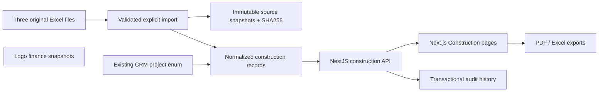

# Construction workspace — 22 October 2026

## Scope and verified project identity

The CRM already has separate `ProjectType` values `LA_JOYA_PERLA` and `LA_JOYA_PERLA_II`. A read-only Supabase query on 22 October found 354 customer-unit records for Perla and 129 for Perla II (three cancelled records in Perla II). These are ownership/customer records, not an authoritative inventory of physical units. The workbooks remain separate:

- Perla: 372 tracked areas, 368 included in the source summary, 31 trades, 11,532 progress entries; claim 13 dated 2026-03-30, 15 work items.
- Perla II: 106 budget items in ten categories. No imported progress or claims.
- Four D-block `REST.` rows stay outside the source summary; `9-10-11` remains one tracked row. No automatic customer-unit join.
- The workbook titled PERLA 2 is provisionally associated with the existing Perla II project; the budget owner must confirm the precise phase and coverage.

## Architecture



There is no write path to Logo tables, customers, ownership records, finance payments or email campaigns. No background import, no formula execution from Excel, and no mail sending.

### Stored entities (Prisma / PostgreSQL)

| Entity | Purpose |
|---|---|
| ConstructionProject | Separate construction scope linked to the canonical CRM project enum |
| ConstructionSource | File name, kind, hash, date provenance and original nonempty cells/formulas |
| ConstructionTrade | Project-specific work names, order and percentage weights |
| ConstructionUnit | Source block/label, scope inclusion, source address; not a customer record |
| ConstructionProgress | One unit/trade status, independent quality result, note, inspection time and version |
| ConstructionClaim | Contractor, claim number/date, currency, VAT, signed adjustment, other deduction, baseline net and version |
| ConstructionClaimLine | Previous/measured/accepted quantities, unit, price, source amount, source measurements |
| ConstructionBudget | Project-specific budget and original workbook total |
| ConstructionBudgetItem | Quantity, price, nullable actual quantities/payments, original amount/formula and version |
| ConstructionIssue | Missing information, responsible team, source reference and resolution |
| ConstructionActivity | Actor ID/name, timestamp, reason, before and after values |

Source snapshots are not updated by application endpoints. Financial decimals are stored as Decimal/Numeric; claim document totals use decimal arithmetic, rounded to two places after summing extensions. Weights are percentages, not cost allocation.

## Calculations and known differences

- Progress: sum weights for DONE / sum trade weights. PARTIAL receives no completion credit, matching the workbook. Only included units count in block/project averages. All included units have equal weight.
- Quality: SUITABLE earns full weight, PARTIAL half, UNSUITABLE and UNCHECKED zero. UI shows no quality score until at least one task has been inspected; counts keep unchecked separate from defects.
- Claim: gross extensions + signed adjustment = VAT base; VAT is calculated on that rounded base; other deductions are subtracted after VAT. Source claim net is retained independently. This is a tracking calculation, not legal approval or proof of bank payment.
- Claim 13: gross GBP 141,766.66; adjustment −22,214.60; base 119,552.06; VAT 11,955.21; net 131,507.27.
- New periods copy trade names, units and rates, carry previous+accepted quantities forward, and start current accepted quantities at zero. Measurement attachments and original source totals are not carried over. Only the latest claim for a contractor can be used to create its next period. Creating that period locks its predecessor against edits to protect carried quantities.
- Budget: each row's own quantity × price; original line amounts and workbook total remain separate. Multi Klima Sistemi is a lump sum with quantity 1. I150 in the source references C148; the application uses row 150's quantity 28 × 30 = 840. Source 3,900; difference −3,060. Source grand total 6,759,063.87; calculated 6,756,003.87.
- Null actuals stay unknown. Paid total is unknown unless all rows have paid amounts; known coverage is explicit. Budget less paid is not asserted as an accounts-payable balance.
- Source cumulative claim errors (minha sign, missing yevmiye, mismatched coverage) are retained in snapshots and review issues, not silently promoted to authoritative cumulative financial totals.

## User interface

A separate Construction navigation group contains Overview, Progress Tracking, Quality Control, Claims, Cost Budget, and Review & Missing Data. One project selector scopes lists. Detail URLs identify the record; navigation links also carry its project query parameter.

- Progress/quality: project → block → unit → work entry. Unit updates record completion and quality separately.
- Claims: list → document → work item → original measurement sheet; edit quantities/rates, VAT/deductions and create next period.
- Budget: category summary → individual items; edit planned quantities/rates and documented manual actuals.
- Review: 16 imported issues, source references, responsible teams, required evidence, searchable response and reopen/resolve controls.
- Source metadata and explanations open from information icons. Main tables use high-contrast text, horizontal scrolling within the table, and 42px action buttons.
- PDF/Excel exports preserve project, scope, source caveats and nulls. PDF fonts support Turkish.
- History dialogs show actor, time, reason and changed values with paginated older entries.

## Access and consistency

Initial policy, pending an approved site-team roster:

- ADMIN: read and edit.
- ACCOUNTING: read/export, no mutation.
- SALES, MANAGER, AFTERSALES, CALLCENTER, PREVIEW: denied, including direct API routes.

JwtStrategy reads the user's active role from the database. The module guard restricts all endpoints and rechecks live identity for writes. Preview impersonation is rejected. New tables have RLS enabled and anonymous/authenticated Supabase REST privileges revoked. Access uses the backend database connection.

Each mutation is transactional with an audit record and mandatory reason. Progress, budget items and review issues have optimistic version checks. Claim line edits increment the parent claim version to serialize document edits. Conflicts return 409 and UI retains the draft. Unknown input, invalid status, nonfinite/negative quantities and missing versions are rejected. Read/update routes scope child IDs to their parent.

## Import and deployment

Migration: `20261022140000_construction_workspace`, already applied to the configured Supabase database. The three source files were imported into new tables; existing modules were not modified by the import.

Review import:

```sh
node scripts/import-construction-workbooks.cjs --directory /path/to/workbooks
```

Apply first import:

```sh
node scripts/import-construction-workbooks.cjs --directory /path/to/workbooks --apply
```

The importer validates structure, status values, weights and expected counts, then uses a single transaction and advisory lock. Repeating the same three hashes is a no-op; a changed source against existing construction data is rejected. Subsequent workbook reconciliation must be designed/approved instead of overwriting operational edits.

Deploy migration before the API. Build API with regenerated Prisma client, then deploy frontend with its existing public API URL pointing to that API. No new secret, external service or email configuration is required. Local review uses API port 3003 and frontend port 3001. The mail queue is disabled for this local API process.

## Validation

- Backend unit tests: `npm test -- --runInBand --watchman=false construction`.
- Navigation tests: `node --test tests/navigation.test.mjs` in web.
- Build: `npm run build` in both repositories.
- Real database and HTTP verification: `node scripts/verify-construction.cjs`. This reads the source records and performs writes only inside an intentionally rolled-back transaction. It checks history, conflicts, next-period carry, baseline totals and role denials. It writes temporary local test credentials with mode 0600; do not publish these.
- Browser verification: `node tests/construction.browser.cjs` in web after the verification script. Real data is read only; all UI test mutations are intercepted and fulfilled with cloned fixtures.

## Information still required / deliberately not invented

Detailed items are in ConstructionIssue and the separate PDF/Excel handover report. They include authoritative project/faze coverage, unit mapping, physical inspection dates, quality inspections, contracts and previous claims, deduction evidence, measured-vs-accepted rules, currency/VAT assumptions, current price dates, and documented actual payments.

This first release does not claim contract approval, bank posting, inventory reconciliation, a complete contractor master, attachments for newly created periods, arbitrary workbook uploads, or automatic transfer between construction and customer finance. Creating additional projects/trade catalogs/budgets currently requires a reviewed import. Team-specific permissions and approval workflow should be completed after the role roster and signed process are supplied.
